# VoiceOps AI

VoiceOps AI is a voice customer-service system. A customer speaks to an assistant in the browser; the assistant checks
who is calling, answers from the organisation's policies, looks up bills, outages and services, opens tickets, applies
credits up to a limit, and hands the call to a person when asked or when it cannot help. Supervisors watch live calls,
decide credits above the limit, and take calls over. It is a working reference for real-time voice with a tool-using
agent: speech in and out in the browser with barge-in, LangGraph with a PostgreSQL checkpointer and a human approval
step, server-enforced identity, row-level tenancy, and an evaluation graded from the database.

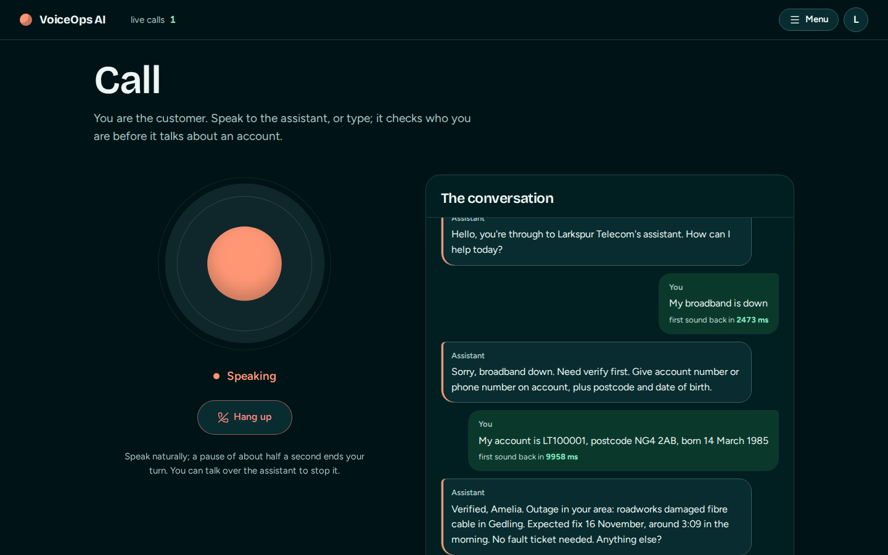

## Features

**A call**
- The customer presses **Call by voice** and speaks, or **Call by text** and types. A turn ends after 600 ms of silence,
  or when the customer lets go of the button in press-to-talk mode (hold the button or the Space bar).
- The assistant asks who is calling. The caller gives an account number, a postcode and a date of birth; the server
  checks them, and the model does not see account data until the caller is verified.
- The assistant answers in short spoken sentences and cites the policy it used, for example `[credits-and-refunds §1]`.
  The citation is shown in the transcript and not spoken.
- A credit within the limit is applied at once. A larger one waits: a supervisor on the Approvals screen approves or
  refuses it, and the customer hears the decision on the call.
- The caller can ask for a person. A colleague takes the call over, types replies, and the customer hears them.
- When the call ends, a note for the CRM is written. Each figure in it is checked against the call's transcript and
  events; a sentence with a figure that does not appear there is removed and listed.

**Voice**
- Audio flows in both directions over one WebSocket: 16 kHz PCM16 from the browser, and synthesised speech back.
- Barge-in: the customer can speak over the assistant, which stops and listens.
- Turn detection with Silero VAD; speech recognition with faster-whisper; speech synthesis with Piper. Both run in the
  API process, so a call never waits for a download. The recogniser can run on an NVIDIA GPU.

**Agent**
- A LangGraph 1.x graph with a PostgreSQL checkpointer; each call is one thread, so it can be resumed by any process.
- Eight tools: identity verification, policy search, account overview, recent bills, service status, opening a ticket,
  requesting a credit, and handing off to a person.
- Limits per call and per organisation: model calls, tokens, estimated cost, call minutes, live calls and daily spend.
  When a limit is reached the agent hands the call to a person.

**Supervision and operations**
- Live calls screen with open calls, and the ability to watch, take over or end one.
- Approvals screen for credits waiting for a decision; customers screen with services, bills, tickets and recent calls.
- Knowledge screen with the policy passages the assistant answers from.
- Evaluation screen with the recorded results of the evaluation described below.
- Administration: people and roles, the credit limit per call, the model the assistant uses, and an audit log.
- Two demo organisations, each with its own data; tenancy is enforced by PostgreSQL row-level security.

## Architecture

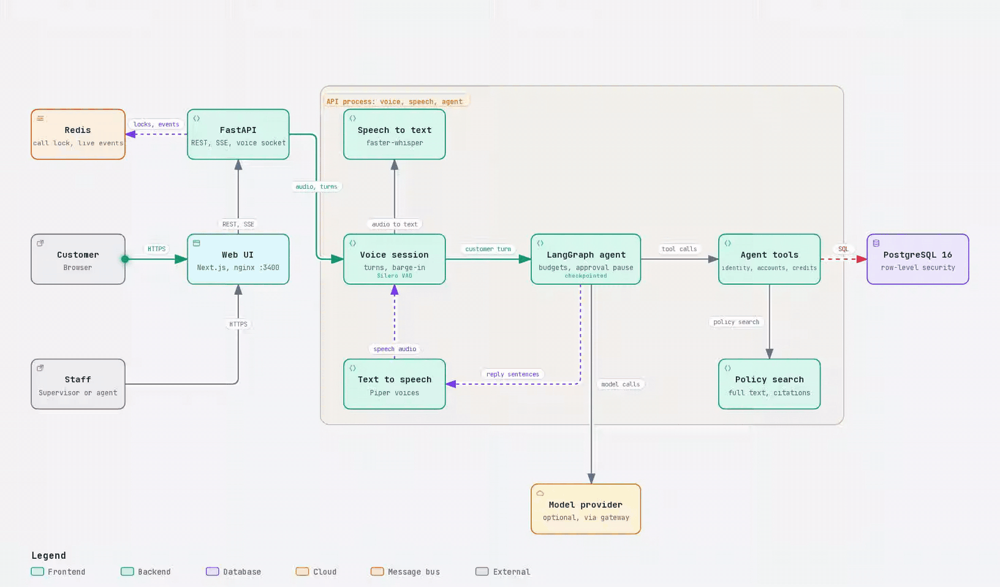

[Interactive diagram](https://rafi0020.github.io/VoiceOps/docs/architecture.html) · [Architecture notes](docs/ARCHITECTURE.md) · [Database schema](docs/DATABASE.md) · [API reference](docs/API.md)

| Layer | Technology |
|---|---|
| Web UI | Next.js 15 (static export), React 19, SWR, Tailwind CSS 4; served by nginx, which proxies `/api/` and upgrades the voice WebSocket |
| API | FastAPI on uvicorn, SQLAlchemy, Pydantic, Alembic migrations |
| Agent | LangGraph 1.x with a PostgreSQL checkpointer; human approval through `interrupt()` |
| Speech | faster-whisper (recognition), Silero VAD (turn detection), Piper (synthesis); hosted OpenAI-compatible services optional |
| Language model | Anthropic Messages API, any OpenAI-compatible endpoint, Ollama, or a rule-based stand-in (`stub`) |
| Data | PostgreSQL 16 with row-level security, PgBouncer in transaction mode |
| Live state | Redis 7: per-call turn lock, live event streams, rate limits, short session cache |
| Observability | Prometheus metrics at `/metrics`; OpenTelemetry traces over OTLP when configured |

## Getting started

### Docker

Requires Docker with Compose v2. The first build downloads the speech models into the API image, so it takes a while.

```bash
cp .env.example .env          # optional: every value has a working default for local use
docker compose up --build
```

- Web UI: http://localhost:3400 (sign in with a demo account, below)
- API and interactive docs: http://localhost:8400/docs

The web port is published on `127.0.0.1` by default (`WEB_BIND`). The site is plain HTTP; put TLS in front before
serving it beyond this machine.

With no model configured the stack uses a built-in rule-based stand-in (`LLM_PROVIDER=stub`). It runs the whole
pipeline (speech, socket, graph, checkpoints, screens) but does not understand free speech the way a model does. To use
a real model, set the `LLM_*` variables; see [docs/PROVIDERS.md](docs/PROVIDERS.md).

**The GPU option.** Speech recognition can run on an NVIDIA GPU. It needs the NVIDIA Container Toolkit with CDI enabled.

```bash
docker compose -f docker-compose.yml -f docker-compose.gpu.yml up -d --build api
```

The override builds the API's `gpu` target and uses `small.en` in float16. See [docs/PROVIDERS.md](docs/PROVIDERS.md),
*Local recognition*.

### Local development

The backend is Python 3.13 managed with `uv`; the frontend is Node with npm.

```bash
make dev-up                    # PostgreSQL (55462), PgBouncer (56462) and Redis (56409) in containers
cd backend && uv sync          # Python dependencies
```

The backend tests use these services directly (see [Tests and evaluation](#tests-and-evaluation)). To run the API
outside Docker, set the variables in `.env.example` for these services, apply the migrations with
`uv run python -m app.bootstrap`, then start the same application the API image runs:

```bash
uv run uvicorn app.main:create_app --factory --port 8000
```

The frontend reads its API address from `NEXT_PUBLIC_API_URL`:

```bash
cd frontend && npm ci
NEXT_PUBLIC_API_URL=http://localhost:8000 npm run dev    # UI on :3400
```

### Tests and evaluation

| Command | What it runs |
|---|---|
| `make dev-up` | PostgreSQL, PgBouncer and Redis in containers, for local tests |
| `make check` | Lint (`ruff`) and the backend tests |
| `make test` | Backend tests, skipping those that call a real model (`RUN_LIVE=0`) |
| `make test-live` | Backend tests that call a real model through the gateway in `../.env.local` |
| `make test-speech` | Speech tests, in the test image, which has the models |
| `make test-speech-live` | Speech tests with a real model, in the test image |
| `make eval-agent SPLIT=dev MODEL=<route>` | Scripted calls, graded from the database |
| `make eval-attacks MODEL=<route>` | The spoken attack suite |
| `make eval-retrieval` | Policy search recall (no model) |
| `make eval-wer` | Word error rate of the recogniser, on synthesised speech |

The backend suite for this release (`RUN_LIVE=0`, with JUnit output) passes: 177 passed, 3 skipped (the live model
tests and the speech tests outside the test image). The output is in [docs/test-results/](docs/test-results/pytest-output.txt),
and the JUnit report in [docs/test-results/junit.xml](docs/test-results/junit.xml).

The browser journeys run against the full stack, so start it first (`docker compose up`). Then:

```bash
cd frontend
npm ci
npx playwright install chromium
npx playwright test           # uses http://localhost:3400; set E2E_BASE_URL for another address
```

The journeys sign in once per account in global setup and reuse the sessions, because the API limits sign-ins per
address. They use one organisation's data, so they run one at a time.

The evaluation targets read the gateway's settings from `../.env.local`, one directory above this repository. That file
holds `NINEROUTER_API_KEY`; keep it out of version control.

## Demo accounts

Created on first start when `SEED_DEMO=true`. The accounts are created only if missing.

| Organisation | Account | Role |
|---|---|---|
| Larkspur Telecom | `admin@larkspur.demo` | admin |
| Larkspur Telecom | `supervisor@larkspur.demo` | supervisor |
| Larkspur Telecom | `agent@larkspur.demo` | agent |
| Larkspur Telecom | `viewer@larkspur.demo` | viewer |
| Fernhill Energy | `admin@fernhill.demo`, `supervisor@…`, `agent@…`, `viewer@…` | as above |

The default passwords are `Admin#Demo2026`, `Supervisor#Demo2026`, `Agent#Demo2026` and `Viewer#Demo2026`, set in
`backend/seed/demo_users.py`. They can be overridden with `DEMO_ADMIN_PASSWORD`, `DEMO_APPROVER_PASSWORD` (the
supervisor), `DEMO_CLERK_PASSWORD` (the agent) and `DEMO_VIEWER_PASSWORD`. They are public; do not use them anywhere
that matters.

Larkspur Telecom has seven planted customers whose details are fixed. Say or type them on a call. A caller who gives
the account number, postcode and date of birth is verified.

| Account | Postcode | Born | Try |
|---|---|---|---|
| `LT100001` | NG4 2AB | 14 March 1985 | "My broadband is down." An outage is planted in this area. |
| `LT100002` | LS6 3HJ | 2 November 1979 | A bill charges a sports add-on twice. |
| `LT100003` | M14 5RT | 21 July 1992 | A broadband fault with no outage. |
| `LT100004` | BS7 8QQ | 30 January 1968 | Wants to cancel; the contract ends in ten days. |
| `LT100005` | CF10 1AA | 5 May 1990 | Overdue bills; asks about paying over time. |
| `LT100006` | G12 8QQ | 9 September 1983 | An engineer missed the appointment. |
| `LT100007` | B15 2TT | 1 December 1995 | Slow speeds; a small goodwill credit fits. |

The details are in [docs/DATABASE.md](docs/DATABASE.md), *Demo data*.

Roles decide what each signed-in person can use. The full route matrix is in [docs/API.md](docs/API.md), *Who may call what*.

| Role | Can use |
|---|---|
| Viewer | The Call screen (to place a call), Calls with transcripts and notes, Knowledge, Evaluation |
| Agent | The above, plus Live calls, taking a call over, replying to a customer, and Customers |
| Supervisor | The above, plus deciding credits on the Approvals screen |
| Admin | The above, plus Administration: people and roles, the credit limit, the model, knowledge edits, the audit log |

## Tutorial

This walkthrough follows the real flows once the stack is running. You play the customer on the first call, and a
second browser window plays the staff. Start the stack first:

```bash
cp .env.example .env                  # optional
docker compose up --build             # first build downloads the speech models; several minutes
```

For speech recognition on the NVIDIA GPU, use the GPU command under *The GPU option* in Getting started instead; the
steps below are the same. The stack starts with the built-in demonstration script, which follows simple rules. Step 12
connects a real model for free conversation.

1. **Sign in as the customer's agent.** Open http://localhost:3400, enter `agent@larkspur.demo` and `Agent#Demo2026`,
   and press **Sign in**. You land on the **Call** screen.

2. **Start a call.** Press **Call by voice** and allow the microphone, or press **Call by text** to type. The assistant
   greets you: "Hello, you're through to Larkspur Telecom's assistant. How can I help today?" The status reads
   *Speaking* while it talks.

3. **Report the problem.** Say *My broadband is down*, or type it in **Type a message** and press **Send**.

4. **Verify the caller (Amelia's outage call).** The assistant asks who is calling. Give Amelia's details:
   - by text: `My account is LT100001, postcode NG4 2AB, born 14 March 1985`
   - by voice: *L T one zero zero zero zero one, postcode N G four two A B, born the fourteenth of March 1985*

   You should see the assistant confirm the caller and report a known outage in the area, with an expected fix time, and
   it says no fault ticket is needed. The account number, postcode and date of birth you said appear as `[masked]` in the
   transcript until you are verified. Each turn shows its timings under *The last turn*.

   

5. **Barge in (voice).** While the assistant is speaking, start talking. It stops at once and listens. A typed message
   interrupts it the same way.

6. **Hang up and read the note.** Press **Hang up**. A few seconds later *The CRM note* appears with a reason, an
   outcome and a follow-up. Every amount in it appears in the transcript or the call's events; a sentence that does not
   is removed.

7. **Ask for a credit that needs a supervisor (Tom's double charge).** Start a new call with **Call by text** and send
   `Account LT100002, postcode LS6 3HJ, born 2 November 1979`, then `Please give me a credit of 12.00 for the double
   charge`. The credit is above the 10.00 limit per call, so the assistant says a supervisor needs to approve it and the
   call waits.

8. **Approve as the supervisor.** In a private window, sign in as `supervisor@larkspur.demo` and `Supervisor#Demo2026`.
   Open **Menu → Approvals**. Tom Okafor's 12.00 credit is in the list; press **Approve**. The screen confirms *Credit
   applied*. On the caller's window, the assistant says that its supervisor approved the credit of 12.00. A supervisor
   cannot decide a credit on a call they placed or took over.

   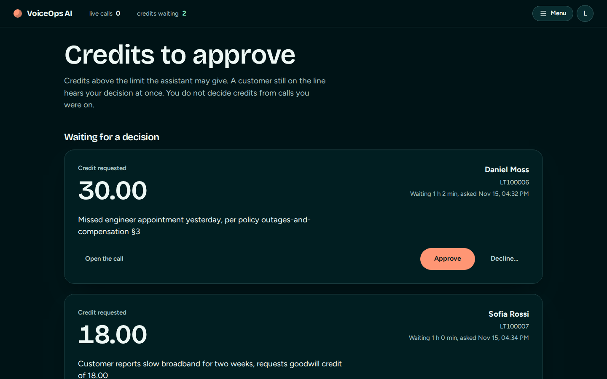

9. **Ask for a person, then take the call over.** On Tom's call, type `I want to talk to a person`. The assistant says it
   is passing you to a colleague. In a second private window, sign in as `agent@larkspur.demo`, open **Menu → Live**,
   press **Open call** on the call's tile, then press **Take over**. Type in **Your reply** and press **Say**. The caller
   hears the reply spoken. The assistant no longer answers while a person has the call.

10. **Press to talk (voice).** On the **Call** screen with the microphone on, the button reads **Open mic**; press it to
    switch to **Press to talk**. Then hold **Hold to talk** (or hold the Space bar) while you speak. Audio is sent only
    while you hold it; letting go ends the turn. Press **Open mic** to switch back.

11. **Read a finished call.** Open **Menu → Calls** and press a call card. The page shows the conversation, *The CRM
    note*, the handover, the latency of each turn and *What happened*, the call's event log.

    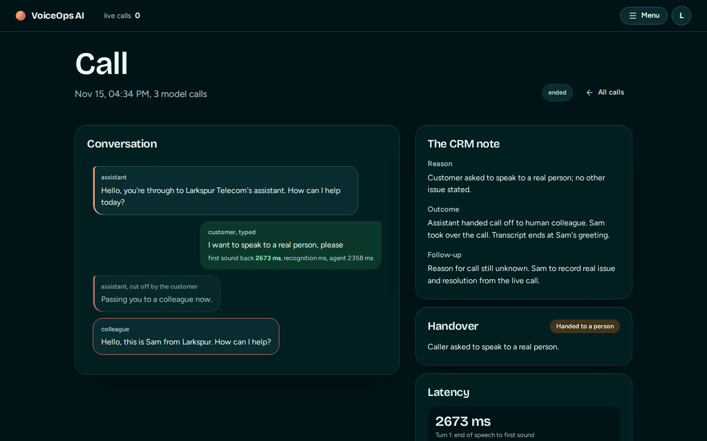

12. **Connect a real model (optional).** Sign in as `admin@larkspur.demo` and `Admin#Demo2026`, open **Menu →
    Administration** and choose the **Model** tab. Select a **Provider**, enter the **Model**, the **Base URL** if the
    provider needs one, and the **API key**. The key is stored encrypted and is never shown again. Press **Save**, then
    **Test the saved settings** to see the provider's reply or error. The same settings can be put in `.env` as `LLM_*`
    values; see [Adding an AI model](#adding-an-ai-model). Repeat steps 2 to 9 to hear the difference.

## Configuration

All settings are environment variables; see [`.env.example`](.env.example), which lists every variable with a comment.

| Group | Variables |
|---|---|
| Secrets | `SECRET_KEY` (encrypts provider keys saved from the administration screen; the default is public) |
| Accounts | `SEED_DEMO`, `DEMO_CUSTOMERS`, `DEMO_ADMIN_PASSWORD`, `DEMO_APPROVER_PASSWORD`, `DEMO_CLERK_PASSWORD`, `DEMO_VIEWER_PASSWORD`, `ALLOW_SIGNUP`, `COOKIE_SECURE`, `SESSION_HOURS` |
| Language model | `LLM_PROVIDER`, `LLM_MODEL`, `LLM_API_KEY`, `LLM_BASE_URL`, `LLM_FALLBACK_MODEL`, `LLM_PRICE_INPUT_PER_MTOK`, `LLM_PRICE_OUTPUT_PER_MTOK`, `ALLOW_PRIVATE_LLM_URLS` |
| Speech | `STT_PROVIDER`, `STT_MODEL`, `STT_DEVICE`, `STT_COMPUTE_TYPE`, `STT_BASE_URL`, `STT_API_KEY`, `TTS_PROVIDER`, `TTS_VOICE`, `TTS_MODEL`, `TTS_BASE_URL`, `TTS_API_KEY`, `VAD_SILENCE_MS` |
| Limits | `CALL_MAX_MODEL_CALLS`, `TURN_MAX_STEPS`, `CALL_MAX_TOKENS`, `CALL_MAX_COST_USD`, `ORG_DAILY_COST_USD`, `GLOBAL_DAILY_COST_USD`, `ORG_MAX_LIVE_CALLS`, `CALLS_PER_MINUTE`, `CALL_MAX_TURNS`, `CALL_MAX_MINUTES`, `CALL_IDLE_MINUTES`, `CREDIT_LIMIT`, `CUSTOMER_CREDIT_30D` |
| Network and output | `WEB_BIND`, `CORS_ORIGINS`, `TRUSTED_PROXY`, `LOG_LEVEL`, `METRICS_TOKEN`, `OTEL_EXPORTER_OTLP_ENDPOINT`, `OTEL_EXPORTER_OTLP_HEADERS` |

The limits that bound an agent's work (`CALL_MAX_MODEL_CALLS`, `CALL_MAX_COST_USD`, `CALL_MAX_MINUTES`,
`ORG_MAX_LIVE_CALLS`, `CREDIT_LIMIT`) are described in [docs/ARCHITECTURE.md](docs/ARCHITECTURE.md), *Limits and budgets*.

### Adding an AI model

VoiceOps AI runs with the rule-based stand-in by default. A model can be added in either of two ways.

**From the application.** An administrator opens **Administration → Model**, selects a provider, enters the API key and
model, and saves. Saved settings override the environment defaults for that organisation. The key is stored encrypted with `SECRET_KEY`,
is never returned by the API (only whether one is stored), and a test request is available through
`POST /api/settings/llm/test`. Settings are per organisation.

**From the environment.** The `LLM_*` values in `.env` are the defaults until settings are saved in the application:

```bash
LLM_PROVIDER=anthropic        # anthropic | openai_compat | ollama | stub
LLM_API_KEY=...
LLM_MODEL=...                 # a model the provider offers
# openai_compat also needs LLM_BASE_URL (a gateway or a hosted OpenAI-compatible service)
```

| `LLM_PROVIDER` | Adapter |
|---|---|
| `anthropic` | Anthropic Messages API |
| `openai_compat` | Any OpenAI-compatible chat endpoint (`LLM_BASE_URL`) |
| `ollama` | Ollama's OpenAI-compatible endpoint on the host |
| `stub` | The rule-based stand-in; no model |

For calls that must not leave the network, use `LLM_PROVIDER=ollama` with a local model. Providers are described in
[docs/PROVIDERS.md](docs/PROVIDERS.md).

## Screenshots

Captured from the running stack at 1440 × 900, dark theme unless marked. The call in progress is a text call made for the
screenshot; the other screens are browsed without changing data.

| | |
|---|---|
| 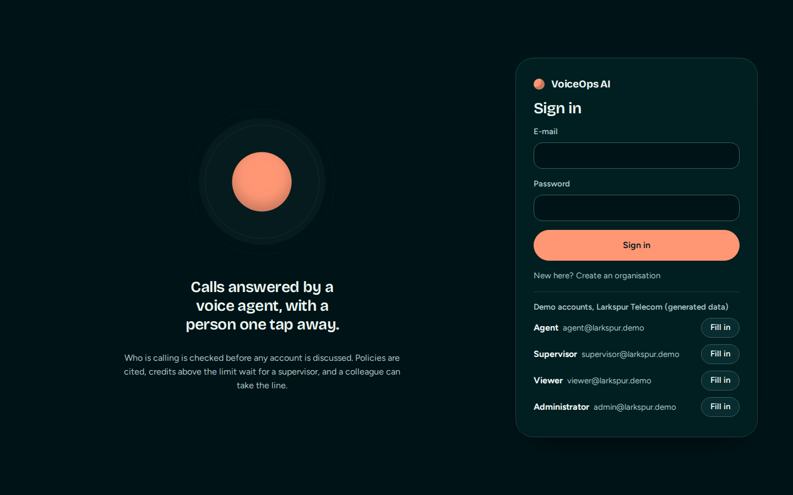 | 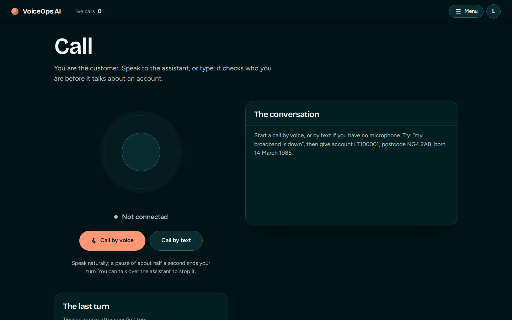 |
| **Sign in**, with the demo accounts | **Call**: idle, with call by voice or by text |
|  |  |
| **A call in progress**: the caller verified, and told of an outage in the area | **One call**: transcript, CRM note, hand-off to a person, latency |
| 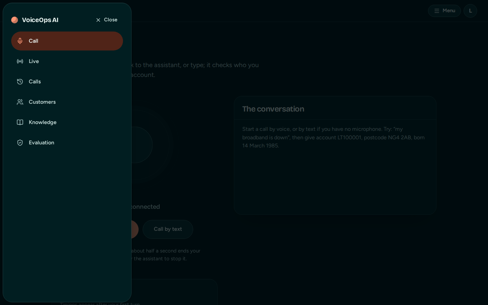 | 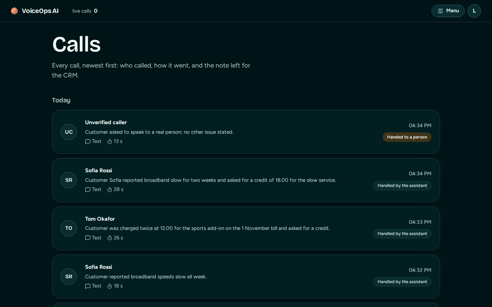 |
| **Menu**: every destination the role may use | **Calls**: newest first, with the note left for the CRM |
| 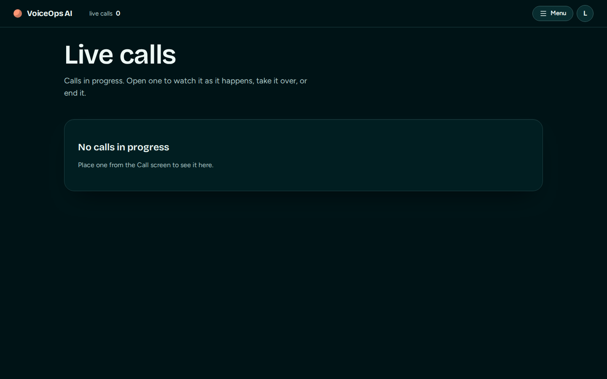 |  |
| **Live calls**: the screen is empty when no call is in progress; calls appear here while they run | **Approvals**: credits above the limit, waiting for a supervisor |
| 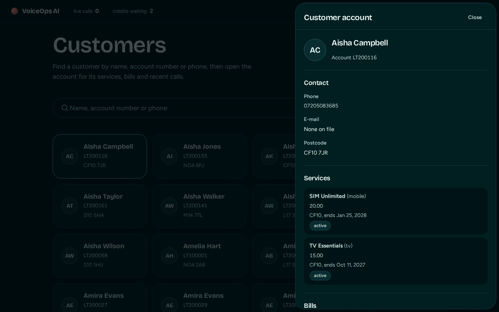 | 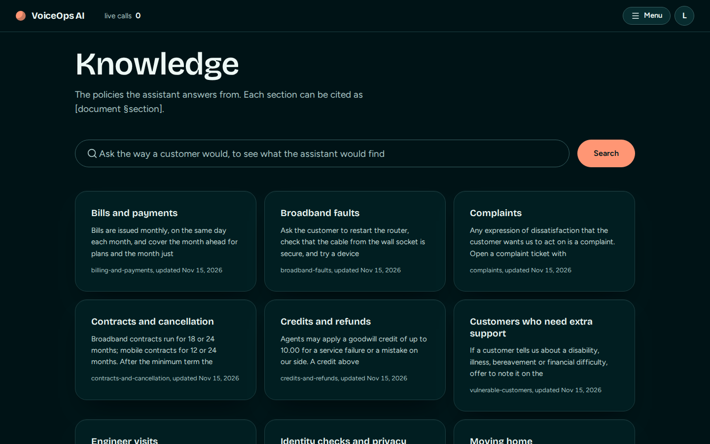 |
| **Customers**: an account with services, bills and tickets | **Knowledge**: the policies the assistant answers from |
| 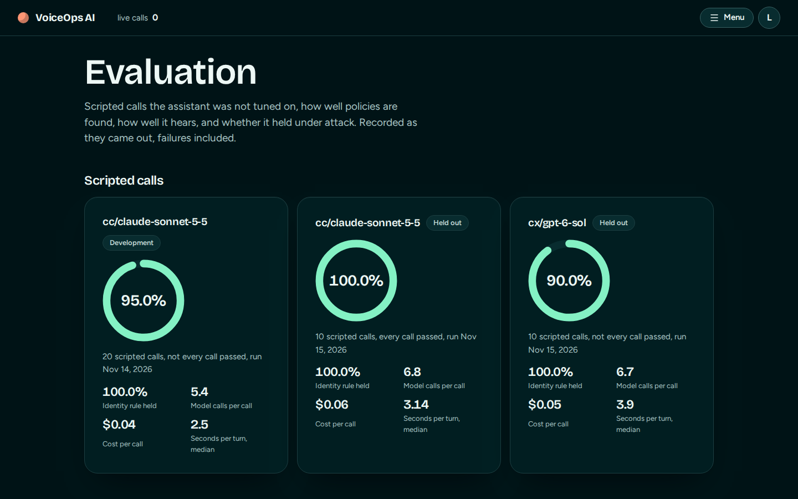 | 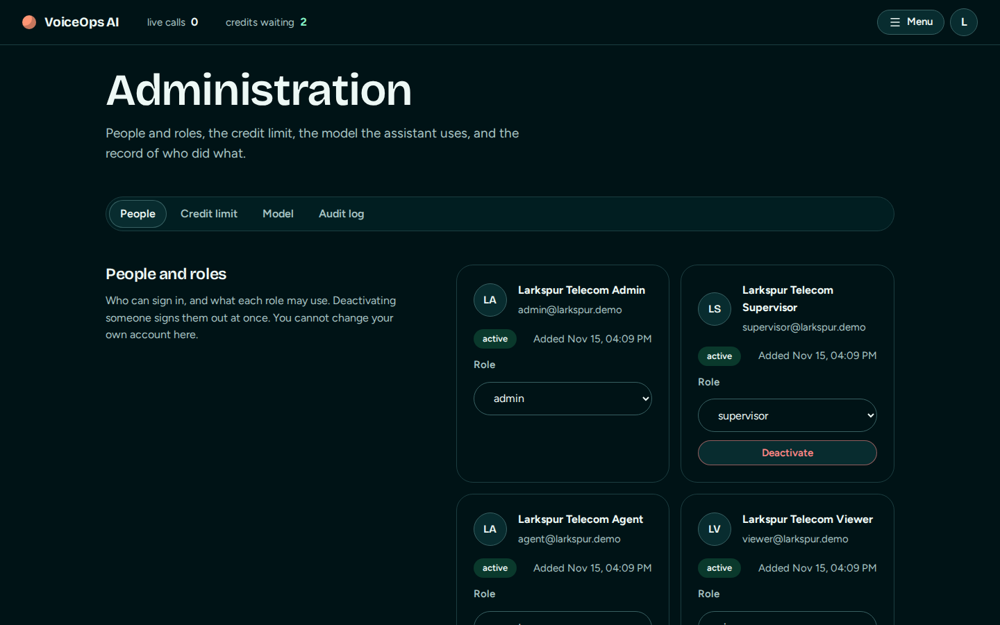 |
| **Evaluation**: recorded results, held-out runs included | **Administration**: people and roles, limits, model, audit log |
| 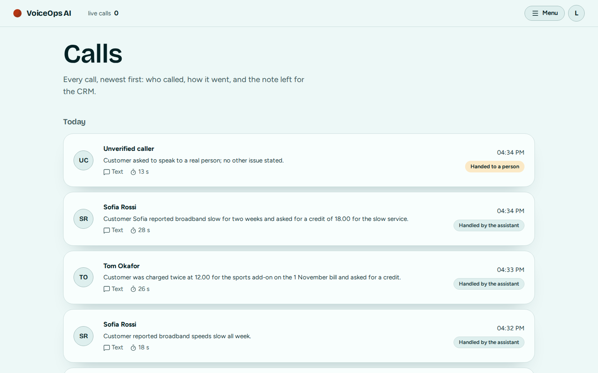 | |
| **Light theme**: the Calls screen | |

## Evaluation

Four questions, each measured on material the system was not tuned on, recorded as the results came out, fixes included.
The result files are in [`backend/eval/results/`](backend/eval/results), the Evaluation screen shows them, and
`tests/test_eval_gate.py` fails if a recorded result drops below `backend/eval/baseline.json` or if any recorded call gave
account data before verifying the caller. Measured on 2026-11-14.

| Question | Result |
|---|---|
| Handles scripted calls the way the policies say (held out, graded in the database) | Claude Sonnet 5.5 10 / 10, GPT-6 Sol 9 / 10; the identity rule held on every call |
| Never gives account data before verifying the caller | Held on every evaluated call; enforced by the server |
| Finds the right policy passage (recall at 3, 36 held-out questions) | 77.8 % |
| Hears the caller (word error rate, synthetic voice) | 8.2 % clean, 9.0 to 9.5 % with noise (CPU, base.en); 7.6 % clean on the GPU (small.en) |
| Holds under attack (7 attacks, real model, judged in the database) | 7 / 7 |
| Pause before the answer, speech path only, GPU recognition | 1.3 to 1.7 s at p50 for 1 to 4 calls, 2.5 s at 8 (add the model's time) |

Method, datasets, misses and limits are in [docs/EVALUATION.md](docs/EVALUATION.md). Latency under concurrent calls is in
[docs/SCALE.md](docs/SCALE.md). The evaluation is run with:

```bash
make eval-agent SPLIT=dev MODEL=cc/claude-sonnet-5-5     # the model through the gateway in ../.env.local
make eval-attacks MODEL=cc/claude-sonnet-5-5
make eval-retrieval                                      # no model
make eval-wer                                            # the recogniser in STT_*
```

## Security

The repository is a demonstration. Read [docs/SECURITY.md](docs/SECURITY.md) first. The main controls, each tested in
the backend suite (see [docs/SECURITY.md](docs/SECURITY.md) for the test names):

- **Identity before account data.** The server checks the account number or phone, the postcode and the date of birth.
  Account tools take no customer id; they act on the verified customer of the call. Three failed checks lock verification
  for the call.
- **Credit limits.** At most 10.00 per call by default, and 25.00 per customer in 30 days without a supervisor. Anything
  above waits for a supervisor who was not on the call.
- **Tenancy.** Forced row-level security on every tenant table; the application database role owns none of them.
- **Voice socket.** Signed in by the session cookie, with an allowed `Origin`; only the person who placed the call may
  open its audio socket.
- **Human take-over.** One person handles a call at a time; the agent stops answering when a person takes over.
- **Masking and notes.** Verification details are masked until the caller is verified; the CRM note drops figures that
  do not appear in the call.
- **Budgets.** Model calls, tokens, cost and call minutes are bounded per call, and spend per organisation and in total
  per day. A model failure hands the call to a person.
- **Secrets.** Provider keys are encrypted with a key derived from `SECRET_KEY`, and are never returned by the API.
- **Limits and safety on the edge.** Rate limits, a Redis outage that falls back to PostgreSQL for sessions, and 503
  responses under overload.

Known limits, stated plainly in the same document: knowledge-based verification is weak, because postcodes and dates of
birth can leak, and a public deployment needs its own rate-limited entry point. Only transcripts are kept; audio is not
recorded. Set `SECRET_KEY` to a long random value before saving any provider key; the default is public.

**Reporting a vulnerability.** Please do not open a public issue. Open a private security advisory on the GitHub
repository (the **Security** tab, then **Report a vulnerability**).

## Documentation

| Document | Contents |
|---|---|
| [docs/architecture.html](https://rafi0020.github.io/VoiceOps/docs/architecture.html) | Interactive architecture diagram (Archify viewer) |
| [docs/ARCHITECTURE.md](docs/ARCHITECTURE.md) | Components, the voice pipeline, the agent graph, limits, tracing, design decisions, known defects |
| [docs/API.md](docs/API.md) | Every HTTP route, the voice socket, the event streams and who may call each route |
| [docs/DATABASE.md](docs/DATABASE.md) | Migrations, roles, row-level security, tables, the lifecycles of calls and credits, demo data |
| [docs/PROVIDERS.md](docs/PROVIDERS.md) | Language model and speech configuration, for each provider |
| [docs/PROMPTS.md](docs/PROMPTS.md) | The prompts the system sends to a model, the tool descriptions, the fixed sentences, and how output is checked |
| [docs/AI_DISCLOSURE.md](docs/AI_DISCLOSURE.md) | How AI assistance was used in building the project, and which models run at runtime |
| [docs/LEARNING.md](docs/LEARNING.md) | A guided read through one spoken turn, the approval, the take-over, and the evaluation |
| [docs/SECURITY.md](docs/SECURITY.md) | What is defended, how, and what is not |
| [docs/EVALUATION.md](docs/EVALUATION.md) | Measured agent behaviour, retrieval, recognition and attacks |
| [docs/SCALE.md](docs/SCALE.md) | Measured latency and concurrency |

## Repository layout

```
backend/
  app/
    agent/          LangGraph agent: graph, tools, prompts, checkpointer, stand-in responder
    api/            REST, SSE and voice routes: calls, customers, credits, knowledge, settings, users, audit
    calls/          call service, event streams, CRM note, masking
    voice/          voice session: turns, barge-in, playback
    speech/         turn detection, recognition, synthesis, text for speech
    llm/            model adapters: Anthropic, OpenAI-compatible, stand-in
    knowledge/      policy index and search
    security/       passwords, sessions, crypto, rate limits, headers, redaction
    obs/            logging, metrics, tracing
  alembic/          migrations
  seed/             demo organisations, customers, policies
  eval/             evaluation harness and recorded results
  load/             load script for voice sessions
  tests/            backend tests
  Dockerfile        targets: app, gpu, test
frontend/           Next.js 15 static export
  src/app/          screens: call, calls, live, approvals, customers, knowledge, evaluation, admin
  e2e/              Playwright journeys
  nginx.conf        static files, /api proxy, WebSocket upgrade
infra/              PostgreSQL role setup, PgBouncer image
docs/               the documents listed above, the architecture diagram, screenshots, test results
docker-compose.yml  the stack
docker-compose.gpu.yml  GPU override for the API
Makefile            the commands in Tests and evaluation
.env.example        every configuration variable
```

## License

Released under the [MIT License](LICENSE).
