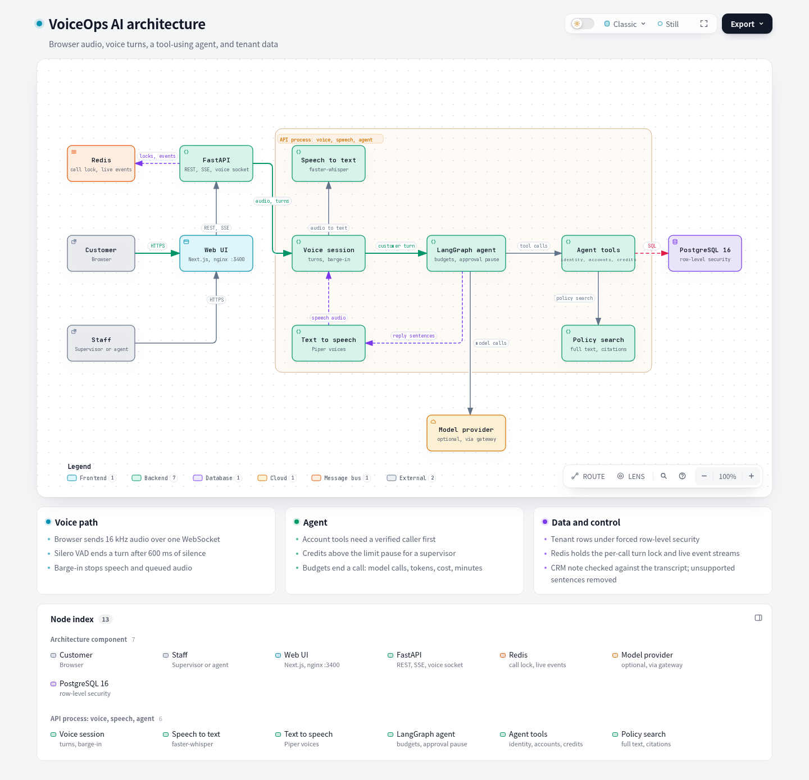
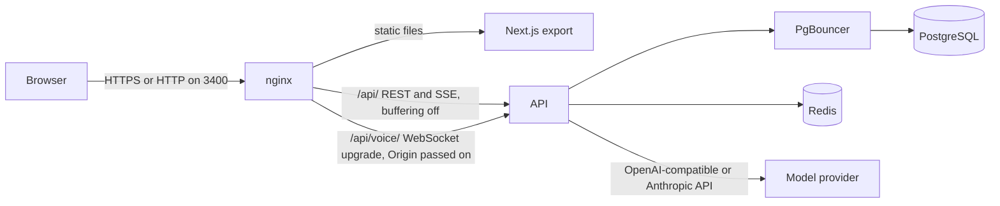
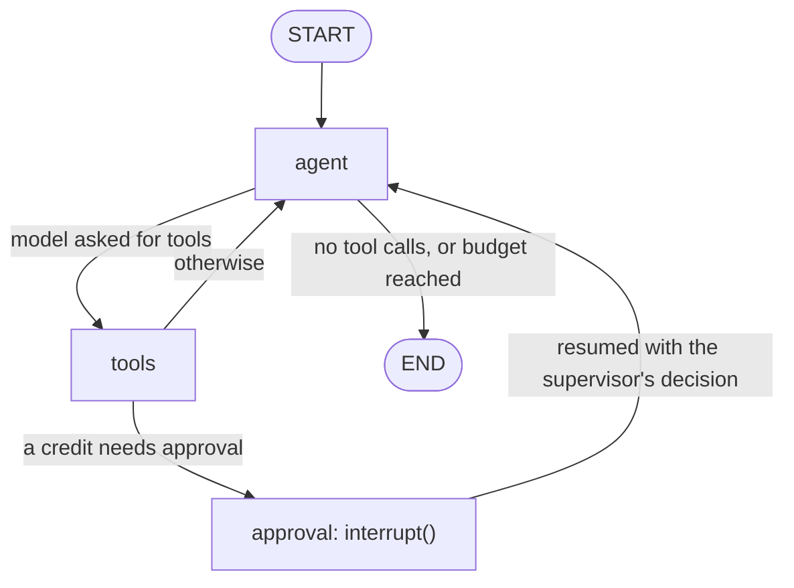

# Architecture

VoiceOps is a voice customer-service system for a telecoms provider. A customer speaks to an assistant in the
browser; the assistant checks who the caller is, answers from the organisation's policies, looks up bills, outages
and services, opens tickets, applies credits up to a limit, and hands the call to a person when needed. A supervisor
watches live calls, decides credits above the limit, and can take a call over.

This document describes how the parts fit together. For the wire formats see `docs/API.md`; for tables see
`docs/DATABASE.md`; for model and speech configuration see `docs/PROVIDERS.md`; for the security model see
`docs/SECURITY.md`; for measured results see `docs/EVALUATION.md` and `docs/SCALE.md`.



The diagram is generated from [`architecture.diagram.json`](architecture.diagram.json); an
[interactive version](https://rafi0020.github.io/VoiceOps/docs/architecture.html) is also available.

## Components

| Component | Where | Role |
|---|---|---|
| nginx | `frontend/nginx.conf`, image `web` | Serves the static Next.js export, proxies `/api/` to the API, upgrades `/api/voice/` to a WebSocket, passes Server-Sent Events through unbuffered |
| API | `backend/app/`, image `api` | FastAPI (uvicorn). Serves the REST and SSE routes, runs the voice sessions, and runs the LangGraph agent in-process |
| PostgreSQL 16 | `db` service | Tenant data behind forced row-level security; LangGraph's checkpoint tables |
| PgBouncer | `infra/pgbouncer/`, `pgbouncer` service | Transaction pooling in front of PostgreSQL |
| Redis 7 | `redis` service | Live call events in streams, the per-call turn lock, rate-limit counters, a short session cache |
| migrate | `backend/app/bootstrap.py`, one-off | Applies Alembic migrations, creates the checkpoint tables, loads demo data, then exits |
| Speech models | in the API image, under `/models` | Piper voices and faster-whisper models, so a call never waits for a download |

There is one process per API container. The model calls, speech recognition and speech synthesis run inside that
process; the only services outside it are PostgreSQL, PgBouncer, Redis, and whatever model endpoint is configured.

### Processes and ports

Ports are as published by `docker-compose.yml`. The three infrastructure ports and the API are bound to
`127.0.0.1`; the web port is published on all interfaces.

| Service | Container port | Published as | Notes |
|---|---|---|---|
| web | 80 | `3400` | The application |
| api | 8000 | `127.0.0.1:8400` | FastAPI docs at `/docs` for the person running the stack |
| db | 5432 | `127.0.0.1:55462` | Owner role for migrations; not used by the API |
| pgbouncer | 6432 | `127.0.0.1:56462` | What the API connects to |
| redis | 6379 | `127.0.0.1:56409` | |

`docker-compose.gpu.yml` changes only the `api` service: it builds the `gpu` target and asks for the GPU through
CDI (`nvidia.com/gpu=all`).

### Request path through nginx



nginx sets `X-Forwarded-For` to the address it saw. The API reads that header only when `TRUSTED_PROXY` is true,
which is the compose default. nginx also sends a Content-Security-Policy with `connect-src 'self'` and
`Permissions-Policy` with `microphone=(self)`.

## The voice pipeline

One WebSocket per call carries 16 kHz PCM16 audio in both directions, plus JSON control messages. The browser never
sees a speech model; the server never sees a browser codec.

```mermaid
flowchart LR
  subgraph Browser
    MIC["Microphone, echo cancellation on"] --> WK["AudioWorklet capture-worklet.js: 16 kHz, 320-sample frames"]
    PL["Player: PCM16 to AudioBuffer, queued back to back"]
  end
  WK -->|"binary frames"| WS1["WebSocket"]
  WS1 --> SOCK["api/voice.py: voice()"]
  SOCK --> SESS["VoiceSession.on_audio"]
  SESS --> VAD["TurnDetector: Silero VAD, 32 ms windows"]
  VAD -->|"turn ended after silence"| STT["transcriber: faster-whisper, or hosted /audio/transcriptions"]
  STT --> CT["service.customer_turn: Redis call lock"]
  CT --> GR["graph.run_turn: LangGraph"]
  GR -->|"whole reply"| SP["text.sentences: citations removed"]
  SP -->|"one sentence at a time"| TTS["synthesizer: Piper, or hosted /audio/speech"]
  TTS -->|"PCM16 in 8 KiB frames"| WS2["WebSocket"]
  WS2 --> PL
  VAD -.->|"speech starts while the agent is speaking: barge-in"| SESS
```



| Stage | Module and function | What happens |
|---|---|---|
| Capture | `frontend/public/capture-worklet.js` (`Capture.process`) | Averages the input for each output sample (a box filter), converts to Int16, posts 320-sample frames (20 ms) to the page |
| Send | `frontend/src/app/(app)/call/page.tsx` (`startMic`) | Sends each frame as a binary WebSocket message unless the microphone is muted. In press-to-talk mode only while the button or Space is held; letting go sends `end_turn` |
| Accept | `backend/app/api/voice.py` (`voice`) | Checks Origin, the session cookie and ownership of the call, then accepts and starts the session |
| Frame intake | `backend/app/voice/session.py` (`VoiceSession.on_audio`, `AudioBudget`) | Drops audio that arrives more than two seconds faster than real time, so one call cannot keep the event loop busy with voice inference; passes each frame to the detector; starts barge-in on a speech start. A broken frame (an odd byte count) is dropped whole by `api/voice.py` |
| Turn detection | `backend/app/speech/vad.py` (`TurnDetector.feed_float`) | Silero VAD on 512-sample (32 ms) windows with its state carried across windows; hysteresis (start 0.5, keep 0.35); 320 ms pre-roll; a turn ends after `VAD_SILENCE_MS` of silence; shorter speech than `VAD_MIN_SPEECH_MS` is ignored; a turn longer than `MAX_TURN_SECONDS` is cut |
| Recognition | `backend/app/speech/stt.py` (`LocalTranscriber`, `HostedTranscriber`) | One recognition at a time per process; the wait is recorded as `stt_wait_ms` |
| Noise filter | `backend/app/voice/session.py` (`is_noise`) | Empty text and Whisper's inventions such as "you" are dropped. "Thank you." and "Bye." are dropped only when the turn is under 0.5 s or quiet (RMS below 0.01); a clear answer reaches the agent |
| Turn | `backend/app/calls/service.py` (`customer_turn`) | Holds the Redis call lock, stores the customer turn (masked until the caller is verified, see `calls/masking.py`), runs the graph, stores the agent turn |
| Answer | `backend/app/speech/text.py` (`sentences`) | Removes citations such as `[credits-and-refunds §1]` from the spoken text and splits into sentences; very short sentences join the next |
| Speech | `backend/app/speech/tts.py` (`LocalSynthesizer`, `HostedSynthesizer`) | Synthesises one sentence at a time; the first sentence's audio is sent as soon as it is ready |
| Playback | `Player` in `call/page.tsx` | Schedules each buffer at the end of the previous one; `clear` stops everything queued |

### Barge-in and turn chaining

`VoiceSession` (`backend/app/voice/session.py`) runs answers one at a time in background tasks while audio input
keeps flowing, and keeps a **playback clock**: audio is sent far faster than it plays (a sentence is synthesised in a
few hundred milliseconds and plays for seconds), so each sentence's start is when the previous one finishes playing.

- **Turns run one at a time, in order.** `_queue` makes each new answer wait for the previous one (`asyncio.wait`, so
  a cancellation of the waiting task still lands); a failure is logged and the caller hears a short apology.
- **Speech while the agent is audible** (audio still being sent, or the playback clock not yet run out): the speaking
  task and any queued speech are cancelled, `{"type": "clear"}` is sent, and the transcript keeps the sentences that
  had started playing (`mark_interrupted`). Answers to earlier turns still run.
- **A reply is spoken only for the latest turn, and not over the caller.** Each turn is numbered when it is queued.
  When a reply is ready: if a newer turn has been queued, it is stored as not spoken (the newer turn is answered,
  with this one in the conversation); if the caller is speaking at that moment, it is held, then dropped if what they
  say becomes a turn or spoken if the sound fades without one (a cough). The graph run is never cancelled mid-node.
- **A reply cut off before its first sentence** played is stored with empty text and `interrupted`; what the agent
  decided is kept in a `reply_not_heard` event, so the record shows what the caller heard and the decision stays visible.
- **Press to talk** (`on_end_turn`): the browser sends audio only while the button is held and then sends `end_turn`;
  the detector ends the turn in progress at once, so no silence is needed.
- **Typed input** (`on_text`) barges in first, then queues a turn exactly like a spoken one.
- **The Redis stream** is watched by `_follow_people`: a person's reply after a take-over is spoken; the agent's words
  after a supervisor's decision (`agent_reply`) are spoken on the live call; a take-over stops the agent's audio at
  once and shows "with a person".
- **The greeting** is queued like any other speech, so it can be spoken over.

Playback is timed on the server from the audio's length; the browser starts playing on receipt, so on a local
network the clock and the speaker agree to within the network delay.

## The agent graph

The agent is a LangGraph 1.x graph (`backend/app/agent/graph.py`) with a Postgres checkpointer. The thread id is the
call id, so each call has its own checkpoint history and can be resumed by any process.



| Node | Function | Responsibility |
|---|---|---|
| `agent` | `graph.agent` | Checks the budgets, calls the model with the system prompt and the tool specifications, records the model call's usage on the call row |
| `tools` | `graph.tools` | Runs each requested tool through `tools.run_tool`, records tool spans, and notes a credit that needs approval |
| `approval` | `graph.approval` | Calls `interrupt()` with the pending credit. Nothing before the interrupt has side effects, because the node runs again from its start when resumed |

Edges: `after_agent` goes to `tools` when the model asked for tools and to `END` otherwise; `after_tools` goes to
`approval` when a credit is pending and to `agent` otherwise. `approval` always returns to `agent`, which then tells
the customer the outcome.

**Budgets** are checked at the start of every `agent` node: model calls within the customer turn (`TURN_MAX_STEPS`),
model calls for the call (`CALL_MAX_MODEL_CALLS`), tokens (`CALL_MAX_TOKENS`) and estimated cost
(`CALL_MAX_COST_USD`). When one is reached the node calls the `hand_off` tool itself, returns a fixed apology, and the
graph ends. The model is not asked again.

**A turn** is `graph.run_turn`: it adds the customer message to the thread, runs the graph until it ends or pauses,
and returns the assistant text added since the turn began (`TurnOutcome.reply`) and any pending interrupt
(`TurnOutcome.waiting`). **A resume** is `graph.resume`, which sends `Command(resume=decision)` on the same thread.

### Modules around the graph

| Module | Contents |
|---|---|
| `app/agent/graph.py` | `CallState`, the three nodes, `build_graph`, `run_turn`, `resume`, `waiting_for`, and the budget check |
| `app/agent/tools.py` | `Tool` registry (`TOOLS`), argument models, `run_tool`, `CallContext`, the spoken-form readers `spoken_code`, `spoken_date` and `_postcode`, and each tool's implementation |
| `app/agent/prompts.py` | `SYSTEM` (the speaking rules, identity rules, policy citation rule and action rules) and `SUMMARY` (the instructions for the CRM note) |
| `app/agent/checkpoint.py` | The async Postgres checkpointer on its own pool; `create_tables` runs the saver's `setup()` as the owner role |
| `app/agent/stub.py` | `demo_responder`, a rule-based stand-in used when `LLM_PROVIDER=stub` (see `docs/PROVIDERS.md`) |

### Tools

Eight tools. Each returns a plain dict to the model and records a `CallEvent` that people and the evaluation read.
A `ToolError` is returned to the model as `{"error": ...}` rather than raised.

| Tool | Needs verified caller | Effect |
|---|---|---|
| `verify_identity` | no | Matches the account number or phone, the postcode and the date of birth on the server; sets `verified_customer_id` on success; three failures lock verification for the call |
| `search_policies` | no | Full-text search over the organisation's passages (top 4), with citations |
| `account_overview` | yes | Plan, active services, balance due, overdue count, recent credits |
| `recent_bills` | yes | The latest `count` bills with their lines |
| `service_status` | yes | Outages in the customer's areas, ongoing or resolved within 7 days |
| `open_ticket` | yes | Creates a ticket (category: fault, billing, complaint, moving, cancellation, other) |
| `request_credit` | yes | Applies the credit if the call's applied total stays within the limit; otherwise records it as `pending` and returns `needs_approval` |
| `hand_off` | no | Sets the call to `handed_off` with a reason, if it is still `live` |

The model never supplies a customer id. `_customer` loads the call's `verified_customer_id` and raises a `ToolError`
if it is empty, so an account tool cannot run before verification.

## The voice session, the call service and the event stream

`app/calls/service.py` owns a call's life: starting it, each customer turn, a supervisor's decision, a take-over, a
person's reply, and ending it.

- **Start** (`start_call`): refuses when the organisation already has `ORG_MAX_LIVE_CALLS` calls not ended; creates the
  call; stores the greeting as the first agent turn; publishes `call_started`.
- **Customer turn** (`customer_turn`): takes the Redis lock for the call (`call:{id}:lock`, waits up to 60 s, then
  answers 409); refuses ended calls; the caller's words have the system-note marker removed; stores the customer turn;
  when the call's time budget (`CALL_MAX_MINUTES`) is spent it hands the call to a person with a polite line and
  calls no model; if the call is `handed_off`, returns no reply; if the graph is paused for approval, answers with the
  fixed "still waiting" sentence and does not start a new graph run; otherwise runs the graph and stores the reply.
- **Turn numbers** are taken under the call's row lock (`SELECT ... FOR UPDATE`), so a person's reply and a customer's
  turn at the same moment get distinct numbers.
- **Decision** (`decision_reached`): resumes a paused graph with the supervisor's decision and stores what the agent
  says next, when the call is still `live`.
- **Take-over** (`take_over`): only one person can hold a call; sets `handed_off` and `handled_by`.
- **End** (`end_call`): writes the CRM note (`calls/summary.py`), sets `ended`, `ended_at` and `summary`, and publishes
  `call_ended`.

`app/calls/events.py` publishes every change to Redis streams:

| Stream | Key | Contents | Retention |
|---|---|---|---|
| Per call | `call:{call_id}:events` | Every event kind for that call | About 2,000 entries (approximate `MAXLEN`), key expires after 24 hours |
| Per organisation | `org:{org_id}:calls` | `call_started`, `call_state`, `call_ended`, `turn`, `approval_needed` | Same |

`events.sse` turns a stream into Server-Sent Events, resuming after the browser's `Last-Event-ID`. PostgreSQL
remains the record: the streams are a live copy, and `GET /api/calls/{id}` returns the stored turns and events.

### The CRM note

`calls/summary.py` asks the model for JSON with `reason`, `outcome`, `follow_up` and `sentiment`. `ground` then
removes every sentence in `reason`, `outcome` or `follow_up` that contains a number not present in the transcript or
the call's events, and lists the removed sentences in `unsupported`. If the model's answer is unusable, a plain note
is stored with `written_by: system` and nothing is marked unsupported.

## Tenancy and database roles

Every tenant table has `org_id` and forced row-level security. The application never filters by organisation in its
queries; it sets the organisation for one transaction:

```python
async with tenant_session(user.org_id) as db:   # set_config('app.org_id', ..., true)
    ...
```

`set_config(..., true)` is `SET LOCAL`, so the setting lasts for the transaction only. That matters because PgBouncer
runs in transaction mode: a session setting would leak to the next client on the same server connection. The
`server_reset_query` (`DISCARD ALL`) and the per-transaction setting together make that safe.

Two roles exist (`infra/postgres/init.sh`):

| Role | Used by | Owns tables | Subject to RLS |
|---|---|---|---|
| `voiceops_owner` | Alembic migrations, `create_tables` for the checkpoint tables | yes | yes (FORCE), so owner-level queries still need an organisation set |
| `voiceops_app` | The API, through PgBouncer | no | yes |

`system_session()` sets `app.system`, which lets a transaction see the identity tables for sign-in and the
organisation table for sign-up. Only `users` and the organisation and session tables are reached that way; see
`docs/DATABASE.md`.

## Redis

| Key | Written by | Purpose |
|---|---|---|
| `call:{id}:lock` | `service.call_lock` | One turn per call at a time, across processes. A 30 s lease, renewed every 10 s while the turn runs; released by one compare-and-delete script, so a holder whose lease ran out cannot delete someone else's lock |
| `call:{id}:events`, `org:{id}:calls` | `calls/events.publish` | Live streams for the Live screen and for the call's own screen |
| `rl:{name}:{who}` | `security/ratelimit.hit` | Sliding-window rate limits (sorted sets of timestamps) |
| `sess:{sha256 of token}` | `security/sessions.resolve` | Resolved sessions for up to 60 s; revocation deletes the entry |

Redis is never the source of truth. When Redis is unavailable, rate limits return 503 with `Retry-After`, sessions
are read from PostgreSQL (the cache is an optimisation), and readiness fails. The call lock raises an error from the
Redis client, which ends the turn with a server error for that request.

## Limits and budgets

| Limit | Setting | Default | Enforced in |
|---|---|---|---|
| Model calls within one customer turn | `TURN_MAX_STEPS` | 6 | `graph.agent` |
| Model calls for the call | `CALL_MAX_MODEL_CALLS` | 80 | `graph.agent` |
| Tokens for the call | `CALL_MAX_TOKENS` | 200000 | `graph.agent` |
| Estimated cost for the call, USD | `CALL_MAX_COST_USD` | 0.50 | `graph.agent` |
| Cost per organisation per day, USD | `ORG_DAILY_COST_USD` | 20.00 | `graph.agent`, `summary.write_summary` |
| Cost for all organisations per day, USD | `GLOBAL_DAILY_COST_USD` | 200.00 | `graph.agent`, `summary.write_summary` |
| Live calls per organisation | `ORG_MAX_LIVE_CALLS` | 20 | `service.start_call` |
| Calls started per minute | `CALLS_PER_MINUTE` | 10 | `api/calls.py` (keyed by client address; see `docs/API.md`) |
| Credit applied per call without a supervisor | `CREDIT_LIMIT`, or the organisation's `org_call_settings` | 10.00 | `tools.request_credit` |
| Credit amount a request may name | fixed | at most 500.00 | `tools.request_credit` |
| Length of a call | `CALL_MAX_MINUTES` | 20 | `service.customer_turn`: the agent hands the call to a person |
| Model calls in flight per process | `LLM_MAX_CONCURRENCY` | 16 | `llm/base.py` |
| Verification attempts per call | fixed | 3 | `tools.verify_identity` |
| Shortest speech counted as a turn | `VAD_MIN_SPEECH_MS` | 250 | `vad.TurnDetector` |
| Silence that ends a turn | `VAD_SILENCE_MS` | 600 | `vad.TurnDetector` |
| Longest turn before it is cut | `MAX_TURN_SECONDS` | 30 | `vad.TurnDetector` |
| Voice socket frame | fixed | 64 KiB, larger frames dropped; an odd-length frame dropped; a text frame that is not a JSON object ignored | `api/voice.py` |
| Audio ahead of real time | fixed | two seconds; the rest is dropped | `voice/session.AudioBudget` |
| Idle voice socket | fixed | 300 s with no message | `api/voice.py` |

The daily cost limits are enforced before every model call (`graph.agent`) and before the CRM note's call
(`summary.write_summary`), as the defects below record.

## Tracing

`app/obs/tracing.py` emits one span per model call and one per tool call, using the OpenTelemetry GenAI attribute
names. The trace id is the call id (both are 128-bit), so every span of a call reads as one trace.

| Span | Name | Attributes |
|---|---|---|
| Model call | `chat <model>` | `gen_ai.operation.name`, `gen_ai.request.model`, `gen_ai.usage.input_tokens`, `gen_ai.usage.output_tokens`, `voiceops.run.id` (the call id), `voiceops.org.id`, `voiceops.step.index` |
| Tool call | `execute_tool <name>` | `gen_ai.operation.name`, `gen_ai.tool.name`, the same identifiers |

Prompts, completions and tool arguments are never put on spans. Nothing is exported unless
`OTEL_EXPORTER_OTLP_ENDPOINT` is set; then spans go to that endpoint with `/v1/traces` appended, in batches, and the
exporter reads `OTEL_EXPORTER_OTLP_HEADERS` from the environment. Speech recognition and synthesis are not spanned;
their timings are in the turn's `timings` (see `docs/API.md`, `latency`).

The per-turn timings written to each turn, and sent to the browser as `latency` messages, are: `audio_ms`, `stt_ms`,
`stt_wait_ms`, `agent_ms`, `tts_first_ms`, `first_audio_ms` (end of the customer's speech to the first sound back) and
`reply_ready_ms`.

## Request path: a typed turn

1. The browser posts `POST /api/calls` (the greeting comes back in the response).
2. The browser opens `ws(s)://…/api/voice/{call_id}`. The server checks the Origin, the session and ownership, then
   sends the greeting if it is the only turn, and `state: listening`.
3. The user types a message; the browser sends `{"type": "text", "text": ...}`.
4. `VoiceSession.on_text` barges in, then queues `_respond`.
5. `_respond` calls `service.customer_turn`, which takes the call lock, stores the customer turn, runs the graph (model
   calls and tool calls as needed), stores the agent turn, and publishes to the call stream.
6. The reply is split into sentences and synthesised one at a time; audio frames go back on the socket.
7. `latency` and the call state are sent; the Live screen sees the same turns through the organisation stream.

The same path serves a spoken turn; only step 3 differs, and step 5 is preceded by recognition.

## Design decisions

| Decision | Choice | Trade-off |
|---|---|---|
| Transport | WebSocket carrying PCM16 both ways | WebRTC would have lower network latency and built-in transport features; it needs ICE and STUN in containers and is harder to test. A WebSocket goes through the same nginx as the rest of the API and lets the evaluation drive the production pipeline from recorded audio. TCP head-of-line blocking hurts on poor networks. Replacing the transport changes one module. |
| Agent framework | LangGraph 1.x with a Postgres checkpointer and `interrupt()` | A state machine with an explicit approval pause that survives a restart, at the cost of a framework dependency and the checkpoint tables. |
| Approval | A credit over the limit pauses the graph; a supervisor's decision resumes it | The customer waits for a decision that may come later. While paused, the customer's further turns get a fixed reply, so the graph never has two runs on one thread. |
| Identity | Enforced by tools on the server, not by the prompt | The model cannot read account data it has not been allowed to reach. Verification relies on details that leak in the real world (see `docs/SECURITY.md`). |
| Model output | Non-streaming completions | A spoken reply starts only after the whole (short) answer is back. The prompt asks for one to three sentences and synthesis works sentence by sentence. Streaming would start sooner and complicate tool calls and citation checks. |
| Retrieval | PostgreSQL full-text search, weighted by section | No vector store and no embedding model to run. Retrieval quality is measured instead (`docs/EVALUATION.md`). Vocabulary mismatch is handled by a small, fixed list of everyday phrasings. |
| Speech | Local by default (faster-whisper, Piper), with hosted OpenAI-compatible endpoints as an option | The image is larger and the CPU does the work; a hosted service is simpler to run and may be faster, but sends audio and text outside the deployment. |
| Tenancy | Forced row-level security with a per-transaction setting | Every query runs in a transaction that sets the organisation; a mistake in application code cannot read another organisation's rows. The cost is that owner-level and cross-organisation work needs separate, explicit paths. |
| Live events | Redis streams, with PostgreSQL as the record | Live screens resume after a reconnect from the stream. Publishing is part of each turn, so a Redis outage also stops turns; the stored turns and events are unaffected. |
| Evaluation | Scripted calls graded from the database, not from the transcript text | Checks run on what the system did (tool events, credits, verification), so a fluent wrong answer still fails. |

## Defects found while writing these documents, all fixed

Each was found by reading the code for these documents, then fixed test-first; the test named reproduces it.

1. A model failure during a customer turn was not handled (a 500 over REST, a silent session by voice). Now the call
   is handed to a person with an apology (`test_when_the_model_fails_the_caller_hears_an_apology_and_is_passed_to_a_person`).
2. The daily cost limits were read but not enforced. The agent now checks the organisation's and all organisations'
   spend today before every model call (`test_an_organisation_over_its_daily_model_spend_...`,
   `test_all_organisations_over_the_global_daily_spend_...`); migration 0013 lets a system transaction sum calls.
3. `/metrics` read a `runs` table that does not exist here. It now reports calls by status, tokens, total spend and
   today's spend (`test_metrics_report_calls_tokens_and_spend`).
4. A reply the caller spoke over before hearing it was erased from the record. Its text is now kept and marked
   interrupted (`test_a_reply_the_caller_spoke_over_before_hearing_it_stays_in_the_record`).
5. A credit decision resumed the call whatever credit it was for, and several credits over the limit in one step kept
   only the last. Decisions now carry the credit id and resume only the credit waited on; each pending credit waits in
   turn, and one decided early is read from its row (`test_two_credits_in_one_step_each_wait_...`).
6. A call could not end if its model could not be set up. The summary now falls back to a plain note
   (`test_a_model_that_cannot_be_reached_still_lets_the_call_end_with_a_plain_note`).
7. Rate limits were keyed by address, not by person. The limiter now resolves the session itself
   (`test_the_limit_on_new_calls_is_per_person_not_per_address`).
8. The Origin check admitted a missing Origin. It is now required (`test_a_voice_socket_without_an_origin_header_is_refused`).
9. A mute longer than five minutes closed the socket. The page now pings every minute.
10. Stale names from the sibling project, in docstrings; corrected.
11. The web port was published on every interface. It is now bound to `127.0.0.1` unless `WEB_BIND` says otherwise
    (`test_every_published_port_is_bound_to_this_machine_unless_the_operator_says_otherwise`).

**Minor findings from the final review, fixed** (each test was red before its fix):

- Details given to verify the caller were kept in the transcript and streamed (`test_the_details_a_caller_gives_to_verify_are_masked_in_the_transcript_but_not_for_the_agent`).
- Turn numbers could collide, and the call lock was a fixed 180 s with get-then-delete release (`test_turns_added_at_the_same_moment_are_numbered_apart`, `test_the_call_lock_is_a_short_lease_that_a_running_turn_keeps_renewing`).
- A malformed frame ended the voice socket (`test_a_frame_with_an_odd_number_of_bytes_is_dropped_not_fatal`, `test_a_text_frame_that_is_not_a_json_object_is_ignored`).
- Audio faster than real time was not capped (`test_audio_faster_than_real_time_is_capped_so_one_call_cannot_flood_the_detector`).
- "Thank you." and "Bye." from a clear caller were dropped as noise (`test_a_short_real_answer_reaches_the_agent_but_a_hallucinated_one_from_quiet_does_not`).
- A reply cut off before it was heard kept its decided text as if spoken (`test_a_reply_cut_off_before_its_first_sentence_is_stored_as_not_heard`).
- A caller could speak the system-note marker, and the CRM note accepted amounts the caller said (`test_a_caller_cannot_speak_the_system_note_prefix`, `test_the_note_grounds_amounts_only_in_what_the_agent_and_the_events_say`).
- A phone number shared by two accounts verified the first (`test_a_phone_number_shared_by_two_accounts_is_not_a_way_in`).
- No per-call time budget (`test_a_call_past_its_time_limit_is_passed_to_a_person_politely`).
- An unknown `LLM_PROVIDER` became the stub (`test_an_unknown_llm_provider_is_a_configuration_error_not_the_stub`).
- `temperature` 0 was never sent (`test_temperature_zero_is_sent_to_every_provider`).
- Duplicate e-mail on sign-up or user creation was a 500 (`test_simultaneous_sign_ups_with_one_address_give_one_created_and_one_conflict`, `test_simultaneous_creations_with_one_address_give_one_created_and_one_conflict`).
- An out-of-range `before` was a 500 (`test_an_out_of_range_paging_value_is_a_422_not_a_500`).
- A Redis outage was a 500 on signed-in requests (`test_signed_in_requests_survive_a_redis_outage`).
- An unreadable saved key was a 500 (`test_an_unreadable_saved_key_is_a_clear_error_not_a_crash`).

## Known limits

- The voice socket is held per call by one browser; there is no reconnect. A socket that closes without "end" (a
  closed tab, a dropped network) ends the call on the server too, and a live call with no activity for 30 minutes is
  ended when the organisation's next call starts.
- Speech recognition runs one request at a time per process. Concurrent calls queue for recognition, and the queue
  time is recorded, so `docs/SCALE.md` can show where it begins to matter.
- Anyone who is signed in can start a call (the demo's customer line). A public deployment needs its own rate-limited
  entry point in front of `POST /api/calls`.
- Only transcripts are stored. Audio is not recorded.
- The agent's own checkpoint (LangGraph, PostgreSQL) holds the caller's words as said, including the verification
  details; it is internal and reached only through an authorised call (`docs/SECURITY.md`).
- The voice-activity model runs on the event loop, one window at a time per call. The audio budget bounds how much a
  single client can ask for; a large number of calls would still need the model moved off the loop.

Measured figures are in `docs/EVALUATION.md` (agent behaviour, retrieval, speech recognition, attacks) and
`docs/SCALE.md` (latency and concurrency). This document does not quote them.
