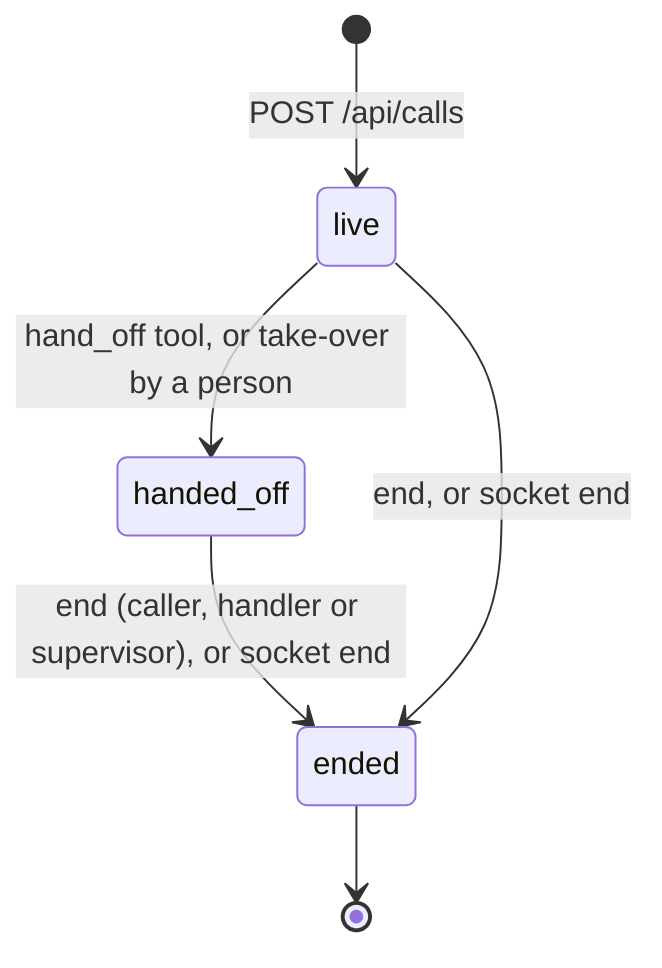

# Database

PostgreSQL 16, reached through PgBouncer in transaction mode. Schema changes are Alembic migrations in
`backend/alembic/versions/`. Tenant isolation is in the database, through row-level security, not in the queries.

## Migrations

| Revision | File | Creates |
|---|---|---|
| `0001` | `0001_identity.py` | The tenant-check functions `app_current_org()` and `app_is_system()`; `orgs`, `users`, `sessions`, `audit_log` |
| `0004` | `0004_llm_settings.py` | `llm_settings` (one row per organisation; the API key encrypted) |
| `0010` | `0010_customers.py` | `customers`, `services`, `bills`, `bill_lines`, `outages`, `tickets`, `credits`, `org_call_settings` |
| `0011` | `0011_calls.py` | `calls`, `turns`, `call_events`; the foreign keys from `tickets.call_id` and `credits.call_id` to `calls` |
| `0012` | `0012_policies.py` | `policy_documents`, `policy_passages` with a generated `tsv` column and a GIN index |
| `0013` | `0013_calls_system_read.py` | `calls` readable by a system transaction too (for `/metrics` and the global daily spend limit); an index on `started_at` |

Revisions form a single chain: `0001` → `0004` → `0010` → `0011` → `0012` → `0013`.

`backend/alembic/env.py` runs migrations as `voiceops_owner`, connecting straight to PostgreSQL (not through PgBouncer).
`app/bootstrap.py` runs `alembic upgrade head`, then `create_tables()` for LangGraph's checkpoint tables (also as the
owner), then loads demo data when `SEED_DEMO=true`. The migrate container runs this once and exits. The test suite
drops and rebuilds the test database from the migrations at the start of each run (`backend/tests/conftest.py`).

Each migration that creates a tenant table calls `enable_rls` (`backend/app/rls.py`) in the same revision, so a table
cannot exist without its policy.

## Roles, connections and the pooler

`infra/postgres/init.sh` runs once, on an empty data directory:

| Role | Purpose | Privileges |
|---|---|---|
| `voiceops_owner` | Owns the schema; migrations, checkpoint tables, and (through the owner URL) nothing at runtime | Owns every table |
| `voiceops_app` | The API and everything it runs | Not an owner. `SELECT, INSERT, UPDATE, DELETE` on tables and usage of sequences, granted by default privileges for the owner |

The script also creates two databases, `voiceops` and `voiceops_test`, owned by the owner role, enables `pg_trgm`
(no migration in this repository uses it), and revokes `CREATE` on schema `public` from `PUBLIC`.

**PgBouncer** (`infra/pgbouncer/entrypoint.sh`) runs in `pool_mode = transaction`. A server connection is held for
one transaction only, so a session setting does not survive to the next transaction, and a different client may get
the same server connection next. Two rules follow, and the code observes both:

- Tenant context is set with `set_config('app.org_id', …, true)` (`SET LOCAL`) at the start of each transaction.
- Prepared statements are off: the engine sets `prepare_threshold: None`, and the checkpointer does too.
- `server_reset_query = DISCARD ALL` clears server state when a connection returns to the pool.

`backend/app/db.py` keeps a pool of `DB_POOL_SIZE` (10) connections per process with 10 overflow, pre-ping on,
recycled after 30 minutes. The checkpointer has its own pool of up to 10. When the application cannot get a
connection in time, the API answers `503` with `Retry-After: 5` (`backend/app/main.py`).

## Row-level security

**The functions** (`0001_identity.py`):

```sql
app_current_org()  -- the organisation set for this transaction, or NULL
app_is_system()    -- true when app.system is 'on' for this transaction
```

**The policy** that `enable_rls` creates on each tenant table:

```sql
ALTER TABLE <t> ENABLE ROW LEVEL SECURITY;
ALTER TABLE <t> FORCE ROW LEVEL SECURITY;
CREATE POLICY tenant_isolation ON <t>
  USING (org_id = app_current_org())            -- with system_access: OR app_is_system()
  WITH CHECK (org_id = app_current_org());
```

`FORCE` applies the policy to the table owner too, so the owner role is also subject to it.

**Setting the organisation.** `backend/app/db.py` provides two context managers:

```python
async with tenant_session(org_id) as db:   # set_config('app.org_id', <org>, true); sees one organisation
async with system_session() as db:         # set_config('app.system', 'on', true); sign-in, sign-up, metrics, global spend
```

With no organisation set, `app_current_org()` is `NULL`, so no tenant row matches. `tests/test_tenant_isolation.py`
checks this (`test_no_org_set_means_no_rows`).

**Which tables have RLS:**

| With RLS | With RLS and `app.system` access | Without RLS |
|---|---|---|
| `audit_log`, `llm_settings`, `customers`, `services`, `bills`, `bill_lines`, `outages`, `tickets`, `credits`, `org_call_settings`, `calls`, `turns`, `call_events`, `policy_documents`, `policy_passages` | `users` | `orgs`, `sessions` |

`orgs` and `sessions` hold no tenant data on their own. `sessions` is read and written only through
`system_session()` (`backend/app/security/sessions.py`), by token hash. `users` is readable from `system_session()`
because sign-in finds a user by e-mail before any organisation is known.

**The audit log** is append-only for the application role: `REVOKE UPDATE, DELETE ON audit_log FROM voiceops_app` in
`0001`. `tests/test_tenant_isolation.py::test_application_cannot_rewrite_the_audit_log` checks it.

**Cross-organisation writes** are refused by `WITH CHECK`. `test_cannot_write_a_row_for_another_org` checks it.

## Audit log

`audit_log` is written in the same transaction as the change it records (`app/api/deps.py::audit`), so a change
and its record commit or roll back together. Each row has the organisation, the acting user, the action
(for example `auth.login`, `user.created`, `credit.decided`, `call.taken_over`, `settings.llm_updated`,
`policy.saved`), the target, redacted detail and the client address. Secret-looking keys are masked before storage
(`app/security/redact.py`).

## Tables

Keys and constraints are as in the migrations. Model classes are in `backend/app/models/`.

### Identity

| Table | Key columns | Constraints and indexes |
|---|---|---|
| `orgs` | `id` (uuid), `name`, `created_at` | |
| `users` | `id`, `org_id`, `email`, `name`, `password_hash`, `role` (`viewer`, `agent`, `supervisor`, `admin`), `is_active` | `email` unique across all organisations; role check; index `users_org_idx` on `org_id` |
| `sessions` | `id`, `user_id`, `token_hash` (SHA-256 of the cookie token), `csrf_token`, `expires_at` | `token_hash` unique; index `sessions_user_idx` |
| `audit_log` | `id` (identity), `org_id`, `user_id`, `action`, `target`, `detail` (jsonb), `ip`, `created_at` | index `audit_org_time_idx` on `(org_id, created_at DESC)`; no UPDATE or DELETE for the app role |

### Model settings

| Table | Key columns | Notes |
|---|---|---|
| `llm_settings` | `org_id` (primary key), `provider` (`openai_compat`, `anthropic`, `ollama`, `stub`), `model`, `base_url`, `api_key_enc`, `fallback_model`, `price_input_per_mtok`, `price_output_per_mtok`, `updated_by` | `api_key_enc` is a Fernet token; the key is derived from `SECRET_KEY` (`app/security/crypto.py`). Empty means no key stored. |
| `org_call_settings` | `org_id` (primary key), `credit_limit` numeric(10,2) default 10.00, `updated_at` | `credit_limit >= 0`. Absent row: the environment's `CREDIT_LIMIT` applies. |

### Customers and what the agent may do

| Table | Key columns | Constraints and indexes |
|---|---|---|
| `customers` | `id`, `org_id`, `account_number`, `name`, `phone`, `postcode`, `date_of_birth`, `email`, `vulnerable` | `UNIQUE (org_id, account_number)`; index `customers_phone_idx` on `(org_id, phone)` |
| `services` | `customer_id`, `kind` (`broadband`, `mobile`, `tv`, `electricity`, `gas`), `plan`, `monthly_price`, `area`, `status` (`active`, `ceased`), `started_on`, `contract_ends` | `services_customer_idx` |
| `bills` | `customer_id`, `period_start`, `period_end`, `issued_on`, `total`, `status` (`paid`, `due`, `overdue`) | `bills_customer_idx` on `(customer_id, issued_on DESC)` |
| `bill_lines` | `bill_id`, `description`, `amount` | `bill_lines_bill_idx` |
| `outages` | `area`, `kind`, `title`, `started_at`, `resolved_at` (null while ongoing), `expected_fix` | `outages_area_idx` on `(org_id, area)`. Matched to services by area and kind. |
| `tickets` | `customer_id`, `call_id` (foreign key to `calls`, set null on delete), `category` (`fault`, `billing`, `complaint`, `moving`, `cancellation`, `other`), `summary`, `status` (`open`, `closed`), `opened_by` (`ai` or `person`) | `tickets_customer_idx` on `(customer_id, created_at DESC)` |
| `credits` | `customer_id`, `call_id` (foreign key, set null), `amount` (> 0), `reason`, `status` (`applied`, `pending`, `refused`), `requested_at`, `decided_by` (user), `decided_at`, `decision_reason` | `credits_pending_idx`, a partial index on `(org_id, requested_at) WHERE status = 'pending'` |

The agent writes `tickets` (`opened_by = 'ai'`) and `credits`. Nothing in the agent's tools updates or deletes a
customer, a service or a bill.

### Calls

| Table | Key columns | Constraints and indexes |
|---|---|---|
| `calls` | `id`, `status` (`live`, `handed_off`, `ended`), `channel` (`voice`, `text`), `started_by`, `verified_customer_id`, `verification_failures`, `handed_off_reason`, `handled_by`, `summary` (jsonb: the CRM note), `model_calls`, `tokens`, `cost_usd` numeric(12,6), `started_at`, `ended_at`, `last_activity` | `calls_org_idx` on `(org_id, started_at DESC)`; partial `calls_live_idx` on `(org_id, last_activity) WHERE status <> 'ended'` |
| `turns` | `id`, `call_id`, `idx`, `speaker` (`customer`, `agent`, `person`, `system`), `text`, `interrupted`, `timings` (jsonb), `created_at` | `UNIQUE (call_id, idx)`. `system` is allowed by the check but nothing writes it. |
| `call_events` | `id` (bigserial), `call_id`, `kind`, `data` (jsonb), `at` | `call_events_call_idx` on `(call_id, id)`. Kinds written: `verification`, `tool`, `ticket`, `credit`, `hand_off`, `take_over`, `credit_decided`, `reply_not_heard` (an agent reply cut off before it was heard: `idx` and the `decided` words). |

Turns hold what was heard: an agent reply cut off before its first sentence has empty `text` and `interrupted`, and
the decided words are in its `reply_not_heard` event. A customer turn said before verification holds `[masked]` where
the account number, postcode or date of birth was said.

`call_events` is the evidence the evaluation and the CRM note are checked against. `verification` events carry the
result and the attempt count, and the customer's id on success; they carry no personal details. `tool` events record
which tool ran, and for policy search the citations returned.

### Policies

| Table | Key columns | Constraints and indexes |
|---|---|---|
| `policy_documents` | `id`, `slug`, `title`, `body`, `updated_at` | `UNIQUE (org_id, slug)` |
| `policy_passages` | `id`, `document_id`, `section` (for example `1`), `title`, `heading`, `body`, `tsv` (generated) | `tsv = setweight(to_tsvector('english', title), 'A') || setweight(to_tsvector('english', heading), 'B') || setweight(to_tsvector('english', body), 'C')`, stored; GIN index `policy_passages_tsv_idx`; `policy_passages_doc_idx` |

Passages are rebuilt, not updated, whenever a document is saved (`app/knowledge/index.py::index_document`). Search
weights are set in the query (`app/knowledge/search.py`): `ts_rank('{0.1, 0.4, 0.5, 0.6}', …)`, so body text weighs
0.4, heading 0.5 and title 0.6.

## LangGraph's checkpoint tables

`app/agent/checkpoint.py::create_tables` runs the checkpointer's `setup()` as the owner role at bootstrap. It creates
four tables in the same database, which `langgraph-checkpoint-postgres` owns:

| Table | Holds |
|---|---|
| `checkpoint_migrations` | The version of the checkpointer's own schema |
| `checkpoints` | One row per graph step: the thread id (the call id), checkpoint id, parent, and the serialised state's metadata |
| `checkpoint_blobs` | The serialised channel values (messages, pending approval) |
| `checkpoint_writes` | Pending writes of a step |

**They are not under row-level security.** They are keyed by thread id, which is the call id, a random UUID. The
server reads a checkpoint only after loading the call under the caller's organisation (`service.load` runs first, under
RLS), so a checkpoint is reached only through an authorised call. `docs/SECURITY.md` states this as a limitation. The
application role has the ordinary table privileges on these tables through the default privileges granted at
initialisation.

## The life of a call



| State | Set by | Effects |
|---|---|---|
| `live` | Default on insert | The agent answers customer turns; counts towards `ORG_MAX_LIVE_CALLS` |
| `handed_off` | `hand_off` tool (only from `live`), or `take_over` (from `live` or from `handed_off` by the same person; refused for another person) | The agent stops answering; a person's replies are spoken; `handled_by` and `handed_off_reason` are set (`take_over` sets a default reason when none exists) |
| `ended` | `end_call` (from any non-ended state) | `ended_at` and `summary` are set; the call no longer counts as live; further turns get `409` |

`ended` is final. `end_call` takes a row lock; a second end returns the stored summary without writing again.

## The life of a credit

```mermaid
stateDiagram-v2
  [*] --> applied: within the call's limit (request_credit)
  [*] --> pending: over the limit; graph pauses for approval
  pending --> applied: supervisor approves (decide)
  pending --> refused: supervisor refuses, with a reason (decide)
  applied --> [*]
  refused --> [*]
```



- **Applied within the limit.** `request_credit` sums the call's `applied` credits and compares the total with the
  limit. The sum counts applied credits only, so a pending credit does not stop a later one that fits.
- **Pending.** The row is inserted with `status = 'pending'`, a `credit` event is recorded, and the tool returns
  `needs_approval`. The graph then pauses in `approval`.
- **Decided.** `POST /api/credits/{id}/decide` locks the row, rejects a decision that is not `pending`, and rejects a
  decider who was on the call. It sets `applied` or `refused`, `decided_by`, `decided_at`, `decision_reason`, records
  a `credit_decided` event, and resumes the call if it is still live and waiting.

A pending credit whose call ends is not decided by the system. It remains `pending` until a supervisor decides it, and
the decision is recorded without the agent speaking it.

## Demo data

Loaded by `seed/generate.py::generate` when `SEED_DEMO=true` and the database holds no customers. Deterministic:
the random generator is seeded (default seed 7), and the planted customers have fixed details.

**Organisations and people.** `seed/demo_users.py` creates Larkspur Telecom and Fernhill Energy with fixed ids, and
for each one a user per role at `<role>@larkspur.demo` and `<role>@fernhill.demo`. The users are created only if
missing, so a later change of the password variables does not change an existing account.

**Ordinary customers.** `DEMO_CUSTOMERS` (200 by default) per organisation, with random names, dates of birth,
postcodes and one or two services each. Larkspur's use the telecom catalogue; Fernhill's use the energy catalogue.
Each has six months of bills, some with random mobile extras.

**Planted customers** (Larkspur only; `PLANTED` in `seed/generate.py`). The evaluation scenarios and the browser
journeys use these details, so they must not change without changing those tests:

| Account | Name | Postcode | Date of birth | Services | What it is for |
|---|---|---|---|---|---|
| `LT100001` | Amelia Hart | NG4 2AB | 14 March 1985 | Broadband, Fibre 150 | Broadband in NG4, where an ongoing outage is planted |
| `LT100002` | Tom Okafor | LS6 3HJ | 2 November 1979 | Broadband Fibre 500, TV | The latest bill charges a 12.00 Sports add-on twice |
| `LT100003` | Priya Nair | M14 5RT | 21 July 1992 | Broadband, Fibre 150 | A broadband fault with no outage in the area |
| `LT100004` | George Bell | BS7 8QQ | 30 January 1968 | Mobile, SIM Unlimited | Contract ends in 10 days; wants to cancel |
| `LT100005` | Hannah Price | CF10 1AA | 5 May 1990 | Broadband and mobile | Two overdue bills; asks about paying over time |
| `LT100006` | Daniel Moss | G12 8QQ | 9 September 1983 | Broadband, Fibre 500 | An engineer missed the appointment; the policy gives 30.00 compensation |
| `LT100007` | Sofia Rossi | B15 2TT | 1 December 1995 | Broadband, Fibre 500 | Slow speeds for two days; a small goodwill credit fits |

The Larkspur outage that `LT100001` sees is an ongoing broadband outage in NG4 that started a few hours before the
seed ran, with an expected fix time after the seed ran; the times are relative to the moment the data is generated. A
resolved mobile outage in SE5 is also planted. Fernhill has one planned electricity outage in EH9, starting in two days.

**Policies.** Larkspur has twelve policy documents (identity and privacy, outages and compensation, credits and
refunds, billing and payments, broadband faults, moving home, contracts and cancellation, roaming, complaints,
vulnerable customers, engineer visits, and handing over). Fernhill has six. Each document is split into `## n. Heading`
sections (`seed/policies.py`). The policies state the figures the evaluation checks answers against, such as the
compensation amount and time limits.
